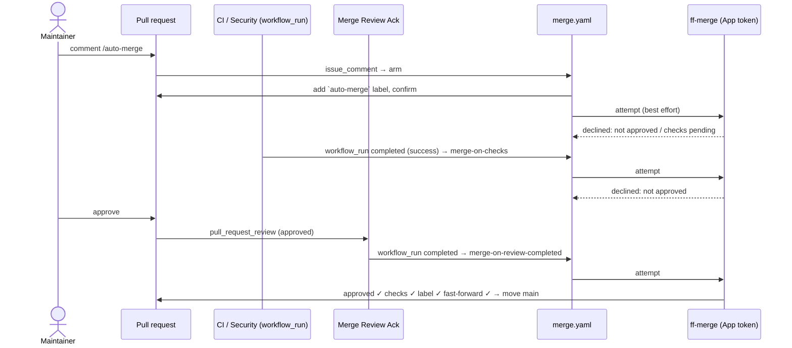

---
description:
  How merge.yaml, merge-review-ack.yaml and merge-notice.yaml together merge PRs by fast-forward without check-list
  clutter.
---

# Fast-forward merging

The organisation merges pull requests by **fast-forwarding** `main` to the PR's head commit. GitHub's merge, squash and
rebase buttons all create new commit objects, which drops the author's signature or replaces it with GitHub's. A
fast-forward moves the ref and leaves the commits untouched, so every signature survives.

Three workflows make up the system:

| Workflow                                                    | Role                                                             |
| ----------------------------------------------------------- | ---------------------------------------------------------------- |
| [`merge.yaml`](../workflows/merge.md)                       | does the merging: `/merge`, `/auto-merge`, event and sweep paths |
| [`merge-review-ack.yaml`](../workflows/merge-review-ack.md) | turns an approval into an event `merge.yaml` can act on          |
| [`merge-notice.yaml`](../workflows/merge-notice.md)         | tells contributors about the convention                          |

## The design constraints

1. **No skipped-check clutter.** Events such as `pull_request`, `pull_request_review` and `pull_request_target` attach a
   check run to the PR. A merge workflow subscribed to them would leave a row of skipped jobs on every PR. So
   `merge.yaml` uses only `issue_comment`, `workflow_run` and `schedule`, none of which attach a check.
2. **Fork PRs must work.** PR-attached events carry no secrets on a fork, so they can't mint the App token. All three of
   `merge.yaml`'s triggers run in the base repository with secrets.
3. **There's no "all checks done" event.** GitHub doesn't fire `check_suite` for runs started by `GITHUB_TOKEN`. So
   `merge.yaml` listens to `workflow_run(completed)` for **every** required workflow, and each completion triggers an
   attempt. ff-merge only moves the ref when the whole status rollup is green.
4. **An approval only exists as `pull_request_review`**, which breaks constraints 1 and 2. The companion
   `merge-review-ack.yaml` solves this: its one job (the only check the system adds to a PR) completes on approval, and
   that completion reaches `merge.yaml` as a `workflow_run`.

## The flow

The order doesn't matter. If the approval comes first, the last CI workflow to finish triggers the merge. If CI finishes
first, the approval does. If an event is missed, the hourly **sweep** finds every open PR with the `auto-merge` label
and tries each one.

`/merge` skips arming: it tries once, immediately, and reports why if it can't merge.

## What ff-merge checks

[`bitwise-media-group/ff-merge`](https://github.com/bitwise-media-group/ff-merge) is the only thing that moves a ref.
Before it does, it checks:

- the actor has write access (and, for `/merge` with `maintainer-only`, maintainer access);
- the PR is **approved** (always on the automatic paths);
- **every** check run and commit status on the head commit is green;
- the arming label is present (`require-label`, on the automatic paths);
- the move is a genuine **fast-forward**, or the PR's author is in `squash-authors`, in which case it squash-merges
  through the API.

The workflow-level gates (org-member comment authors, `conclusion == 'success'`) only filter noise before a token is
minted. ff-merge decides.

## Bot PRs

Renovate never rebases its branches onto `main`, so its PRs can't be fast-forwarded. ff-merge squash-merges PRs from
`squash-authors` (default `bitwise-renovate[bot]`) through the API instead. The result is a `web-flow`-signed commit
that satisfies the required-signatures ruleset. Approval and green checks are still required.

## Org prerequisites

The FF Merge App, its ruleset bypass, and the `FF_MERGE_CLIENT_ID` / `FF_MERGE_PRIVATE_KEY` pair are covered in
[GitHub Apps & secrets](../setup/apps.md#ff-merge). Branch protection on `main` must **require a review**.
