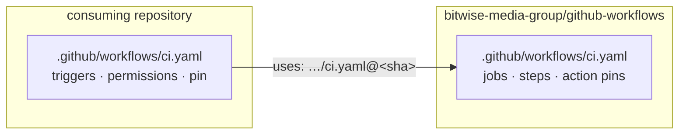

# Overview

`github-workflows` is BitWise Media Group's library of
[reusable GitHub Actions workflows](https://docs.github.com/en/actions/using-workflows/reusing-workflows). CI, CodeQL,
releases, fast-forward merging, Renovate and project sync are written once here, and every other repository runs them
from a short **caller** workflow.

## Callers and reusable workflows

Each reusable workflow in
[`.github/workflows/`](https://github.com/bitwise-media-group/github-workflows/tree/main/.github/workflows) triggers
only on `workflow_call`. It never decides _when_ it runs. That belongs to the caller, a workflow file in the consuming
repository that:

- owns the **triggers** (`push`, `pull_request`, `issue_comment`, `schedule`, …),
- grants the **permission ceiling** (a called workflow's jobs can never exceed the caller's `permissions:`),
- passes **inputs** (`with:`) and **secrets** (`secrets:`), and
- pins the library to a release by full commit SHA.

A ready-made caller for every workflow lives in
[`examples/`](https://github.com/bitwise-media-group/github-workflows/tree/main/examples). Each page under
[Workflows](../workflows/index.md) embeds the current one. Copy it, replace the placeholder SHA, and you're done.

A caller can also run its own jobs next to the reusable one. For example, a Go CLI can keep an `integration` job in the
same `ci.yaml` that calls the reusable CI.

## What to adopt

Most repositories in the organisation carry the full set:

| You want…                                                         | Adopt                                                                                               |
| ----------------------------------------------------------------- | --------------------------------------------------------------------------------------------------- |
| lint, build and test on every PR, with Codecov                    | [`ci.yaml`](../workflows/ci.md)                                                                     |
| CodeQL (and optionally zizmor) code scanning                      | [`security.yaml`](../workflows/security.md)                                                         |
| release-please releases, plus GoReleaser binaries or a docs site  | [`release.yaml`](../workflows/release.md)                                                           |
| merges that keep every commit signature (`/merge`, `/auto-merge`) | [`merge.yaml`](../workflows/merge.md) + [`merge-review-ack.yaml`](../workflows/merge-review-ack.md) |
| a "this repo merges via `/merge`" note on new PRs                 | [`merge-notice.yaml`](../workflows/merge-notice.md)                                                 |
| new issues collected on the org Roadmap board                     | [`add-to-project.yaml`](../workflows/add-to-project.md)                                             |
| dependency updates on the repo's own schedule                     | [`renovate.yaml`](../workflows/renovate.md)                                                         |

## What a repository has to provide

The workflows avoid per-repository configuration by expecting a few things from every consumer:

- **A mise config.** CI, release and docs all run `mise run <task>`. Every toolchain comes from the repository's mise
  pins, usually the shared [toolchain](https://github.com/bitwise-media-group/toolchain) submodule at `.mise/`. See
  [the mise contract](../concepts/mise-contract.md).
- **Org-level GitHub Apps** for the privileged workflows: merge, add-to-project, Renovate, and release when it needs to.
  See [GitHub Apps & secrets](../setup/apps.md).
- **Release config** for `release.yaml`: `release-please-config.json` and `.release-please-manifest.json`.

## Next steps

- [Adopting the workflows](adopting.md) walks through wiring a repository up from scratch.
- [Pinning & upgrades](pinning.md) explains the SHA pins and how Renovate keeps them current.
- The [catalogue](../workflows/index.md) lists every workflow's inputs, secrets and permissions at a glance.
