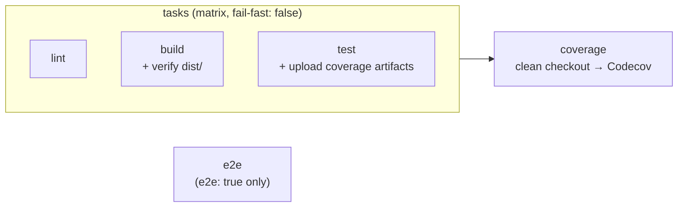

---
description:
  Runs the repo's lint, build, test and docs-build mise tasks as parallel jobs, verifies a committed dist/, and uploads
  coverage to Codecov.
---

# `ci.yaml`

**Reusable Continuous Integration.** Runs the repository's canonical mise tasks (`lint`, `build`, `test`, `docs-build`)
as one parallel job each, checks that a committed `dist/` matches the build, and uploads coverage and test results to
Codecov from a job that never runs PR code. An opt-in `e2e` job runs `mise run e2e`.

!!! abstract "At a glance"

    - **Caller triggers:** `push` to `main`, `pull_request` to `main` / `releases/*`
    - **Caller grants:** `contents: read`
    - **Secrets:** none
    - **Repository needs:** a mise config (`mise.toml` or `.mise/config.toml`)

## How it works



1. **`tasks`**: a four-way matrix over `lint`, `build`, `test` and `docs-build`. Each leg:
   - checks out the repository with submodules, which brings in the toolchain at `.mise/`;
   - installs mise (a pinned version whose binary is sha256-verified) and every tool the repository pins, each
     checksum-verified against `mise.lock` and cached by config hash;
   - asks `mise tasks ls --name-only` whether the task exists and **skips** the leg if it doesn't, so there are no no-op
     stubs;
   - runs `mise run <task>`.

   The `build` leg then runs `git diff --exit-code -- dist` when `dist/` exists. A stale committed bundle, such as a
   JavaScript Action's `dist/`, fails the PR. The `test` leg uploads `coverage/coverage.out`, `coverage/lcov.info` or
   `coverage/cobertura-coverage.xml`, plus `coverage/junit.xml`, as artifacts.

2. **`coverage`**: runs after every `tasks` leg succeeds, in a **fresh checkout that never ran the build**. It downloads
   the artifacts and uploads whichever report exists to Codecov. A rejected upload fails the job on pushes and same-repo
   PRs; on fork PRs, which get no secrets or OIDC token and so upload tokenless, a rejection is logged but doesn't fail
   the PR. Keeping the upload in its own job keeps the Codecov step away from PR-built code. It is tolerant: a
   repository that emits no coverage passes.

3. **`e2e`**: only when the caller sets `e2e: true`. It has no existence check, so opting in without an `e2e` task fails
   loudly.

A repository with **no mise config at all** fails the task-detection step with an explicit error. There is no Makefile
fallback.

## Requirements

- A **mise config** at the root: a `mise.toml`, or the toolchain submodule at `.mise/` loaded as `.mise/config.toml`.
  See [the mise contract](../concepts/mise-contract.md).
- Whichever of `lint`, `build` and `test` do real work. `test` should write one coverage report: Go's
  `coverage/coverage.out`, LCOV at `coverage/lcov.info` (bun test, Swift), or `coverage/cobertura-coverage.xml`. It may
  also write `coverage/junit.xml`.
- No `setup-go` / `setup-node` / `setup-uv`. Go, Node, Python, uv and every dev CLI come from the mise pins, and tasks
  install their own project dependencies (`bun install`, `npm ci`, `go mod download`, `uv sync`).
- Codecov: the repository connected in Codecov, or `coverage: false`.

## Interface

--8<-- "build/workflow-docs/ci/interface.md"

## Permissions

--8<-- "build/workflow-docs/ci/permissions.md"

## Caller

The copy-paste caller from
[`examples/ci.yaml`](https://github.com/bitwise-media-group/github-workflows/blob/main/examples/ci.yaml):

```yaml title=".github/workflows/ci.yaml"
--8<-- "examples/ci.yaml"
```

The caller can add product-specific jobs, such as `integration`, next to the `ci` job.

## Jobs and pinned actions

--8<-- "build/workflow-docs/ci/jobs.md"

--8<-- "build/workflow-docs/ci/actions.md"

## Troubleshooting

`no mise config found` : The repository has neither `mise.toml` nor `.mise/config.toml`. If the toolchain is a
submodule, check that it is committed. The checkout fetches submodules (`submodules: true`).

`no 'build' task defined -- skipping` : Expected for a repository that doesn't define the task. Define it in `mise.toml`
or include an archetype that does.

`Verify dist/ is up to date` fails : Run `mise run build` locally and commit the regenerated `dist/`.

Codecov upload fails : On pushes and same-repo PRs the upload uses `fail_ci_if_error: true`. Set `coverage: false` for a
repository that has no Codecov project. Fork PRs upload tokenless and never fail on a Codecov error (Codecov can reject
them with a misleading "repository is deactivated"); check the `coverage` job log if a fork PR's report is missing.
