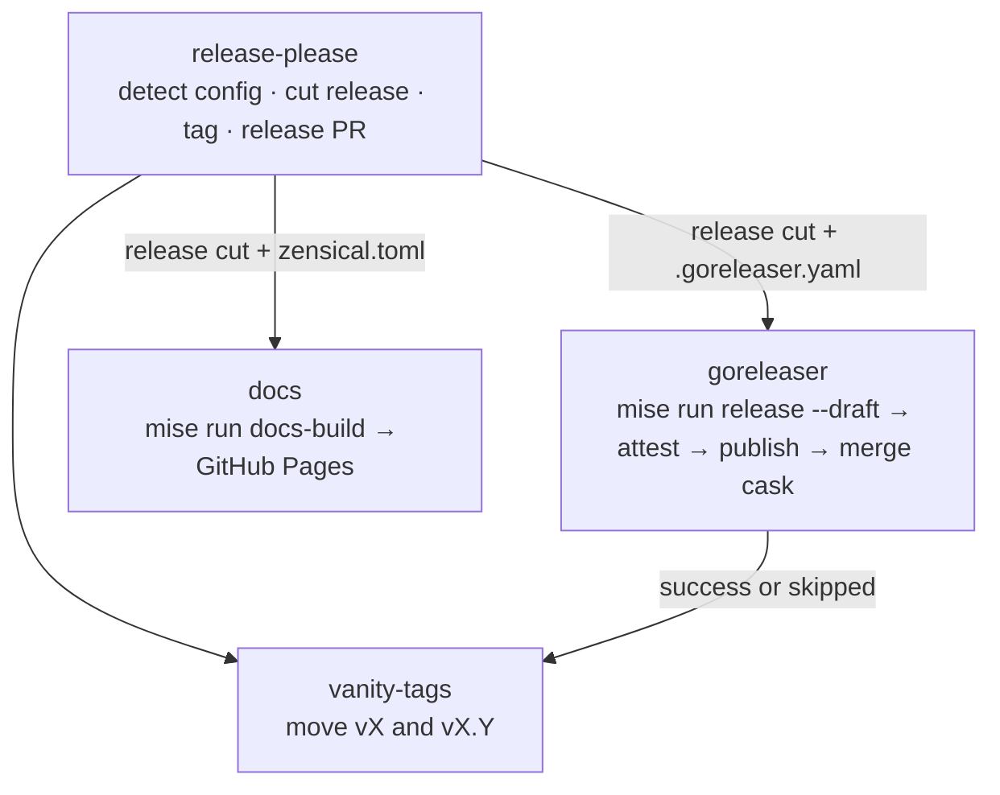

---
description:
  release-please releases, then GoReleaser binaries (signed, notarized, attested) and/or a Zensical docs deploy, then
  floating major/minor tags.
---

# `release.yaml`

**Reusable Release.** release-please keeps a release PR up to date from the Conventional Commit history. When that PR
merges, the run cuts the release. What follows depends on which config files the repository has:

| Repository has     | Path taken                                                                                        |
| ------------------ | ------------------------------------------------------------------------------------------------- |
| `.goreleaser.yaml` | **`goreleaser`**: `mise run release --draft`, attestations, Homebrew cask, then publish the draft |
| `zensical.toml`    | **`docs`**: `mise run docs-build`, then deploy `./site` to GitHub Pages                           |
| both               | both jobs, in parallel                                                                            |
| neither            | the release-please cut is the release                                                             |

With `vanity-tags: true`, a final job moves the floating `vX` and `vX.Y` tags to the release commit.

!!! abstract "At a glance"

    - **Caller triggers:** `push` to `main` (plus `workflow_dispatch` to retry a run that failed at startup)
    - **Caller grants:** all eight scopes below, **even for jobs that will be skipped**
    - **Secrets:** optional: the FF Merge App key; the five `macos-*` notarization secrets
    - **Repository needs:** `release-please-config.json` + `.release-please-manifest.json`

## How it works



### `release-please`

1. Checks out the repository so `hashFiles()` can detect `.goreleaser.yaml` / `.goreleaser.yml` and `zensical.toml`. A
   job-level `if:` runs before checkout, so detection is published as job outputs.
2. If `app-client-id` is set, mints a short-lived **GitHub App token** (`contents` + `pull-requests` write).
3. **Pass one** runs release-please with `skip-github-pull-request`. It only cuts a release, and only when a release PR
   has just merged.
4. **Creates the tag** at the released commit if it doesn't exist. A **draft** release (GoReleaser's `draft: true`) has
   no tag yet, and GoReleaser can't version without one. For a non-draft release the call is idempotent.
5. **Pass two** runs release-please with `skip-github-release` and refreshes the release PR. This happens _after_ the
   tag exists: a draft release without a tag ref is invisible to release-please's lookup, and a single pass would open a
   duplicate release PR.

The job's results become the workflow's outputs (see [Interface](#interface)), so a caller can add release-only jobs.

### `goreleaser`

Runs only when a release was cut, `.goreleaser.yaml` exists, and the trigger is `push`, `workflow_dispatch` or
`schedule`. That trigger list is an allowlist: the job fails closed on any other event, such as a misconfigured
`pull_request_target` caller.

1. Checks out the **release tag** with full history and submodules.
2. Installs mise **without any cache**. A cache poisoned from a less-trusted run must not feed signed, attested
   artifacts. Go, goreleaser, cosign and syft all come from the repository's mise pins, so the release uses the same
   versions as a local `mise run release`.
3. If a root `Dockerfile` / `Dockerfile.*` exists: sets up QEMU and buildx and logs in to `ghcr.io` for GoReleaser's
   `dockers_v2`.
4. If the config declares `homebrew_casks`: fails immediately without `app-client-id`, otherwise mints an App token
   scoped to **only** the tap repository (`contents` + `pull-requests` write).
5. Fails if no `release` mise task exists. The go and swift archetypes define it as `goreleaser release --clean`.
6. Runs **`mise run release --draft`** with `GITHUB_TOKEN`, `HOMEBREW_TAP_GITHUB_TOKEN` and the five `MACOS_*`
   variables. `--draft` overrides the config, so nothing is public yet.
7. **Attests** SLSA build provenance for every file in `dist/checksums.txt`, and for every image in `dist/digests.txt`
   when the repository builds images.
8. **Publishes** the draft release, as the last step that can fail. Published releases are immutable, so everything that
   can go wrong happens while the release is still a draft that can be deleted and re-run.
9. **Merges the cask PR** in the tap (`bot/<repo>-<tag>`, squash) only now that the assets are public, so the tap never
   points at draft assets that 404.

### `docs`

Same trigger allowlist, gated on `zensical.toml`. Independent of `goreleaser`, so the two run in parallel.

1. Checks out the release tag, with Git LFS objects and submodules.
2. Installs mise (cache on: nothing here is signed).
3. Fails if no `docs-build` mise task exists. The toolchain's common tasks define it.
4. Runs `mise run docs-build`, which renders into `./site`.
5. Configures Pages, uploads `./site`, and deploys to the `github-pages` environment. Deploys are serialised in the
   `pages` concurrency group and never cancelled.

A repository whose docs embed generated content overrides `docs-build` to generate it first. This repository does that.
See [Working on the docs](../reference/docs.md).

### `vanity-tags`

Runs when `vanity-tags: true` and a release was cut, **after `goreleaser` succeeded or was skipped**. A failed release
never moves the tags. It force-moves `vX` and `vX.Y` (for example `v8` and `v8.1`) to the release SHA through the API,
with no checkout.

## Requirements

- `release-please-config.json` + `.release-please-manifest.json` at the root.
- **GoReleaser path:** `.goreleaser.yaml` with `release-type: go` and `release.draft: true`, plus a `release` mise task
  (from the go or swift archetype, or your own). An overridden `release` task must leave the git tree clean.
- **Docs path:** `zensical.toml`, `pyproject.toml`, `uv.lock`, a `docs-build` mise task, and **Settings → Pages → Source
  → GitHub Actions**.
- **Container images:** a root `Dockerfile` / `Dockerfile.*` and a `dockers_v2` block. Images go to `ghcr.io` with the
  job's `packages: write`.
- **Auto-merged release PRs:** pass `app-client-id` + `app-private-key` (the FF Merge App). A release PR pushed with the
  default `GITHUB_TOKEN` emits no `workflow_run` events, because GitHub suppresses them to prevent recursion.
  [`merge.yaml`](merge.md)'s auto-merge listens for `workflow_run`, so it would never fire and the PR would only land on
  the hourly sweep.
- **Homebrew cask:** the App above, installed on the tap repository, and a cask config that opens a PR from
  `bot/<repo>-{{ .Tag }}`:

  ```yaml title=".goreleaser.yaml"
  homebrew_casks:
    - repository:
        owner: bitwise-media-group
        name: homebrew-tap
        branch: bot/<repo>-{{ .Tag }} # the branch the workflow merges from
        token: "{{ .Env.HOMEBREW_TAP_GITHUB_TOKEN }}"
        pull_request:
          enabled: true
          base:
            owner: bitwise-media-group
            name: homebrew-tap
            branch: main
  ```

  There is no PAT path. A cask without `app-client-id` fails before anything is built.

- **macOS signing and notarization:** a `notarize.macos` block and the five `macos-*` secrets. See
  [macOS notarization](../setup/macos-notarization.md).

## Interface

--8<-- "build/workflow-docs/release/interface.md"

Gate follow-on jobs in the caller on `release_created`:

```yaml
jobs:
  release:
    uses: bitwise-media-group/github-workflows/.github/workflows/release.yaml@<sha> # vX.Y.Z
  announce:
    needs: release
    if: needs.release.outputs.release_created
    runs-on: ubuntu-latest
    steps:
      - run: echo "released ${{ needs.release.outputs.tag_name }}"
```

## Permissions

--8<-- "build/workflow-docs/release/permissions.md"

!!! warning "Grant everything, even on a docs-only or tag-only repository"

    A repository without `.goreleaser.yaml` never runs the `goreleaser` job, but GitHub still checks its
    `id-token` / `attestations` / `artifact-metadata` / `packages` scopes, and the docs job's `pages`, when the run
    starts. Leave any out and the whole run fails at startup. Only the jobs that actually run receive their
    narrower job-level grants.

## Caller

```yaml title=".github/workflows/release.yaml"
--8<-- "examples/release.yaml"
```

## Jobs and pinned actions

--8<-- "build/workflow-docs/release/jobs.md"

--8<-- "build/workflow-docs/release/actions.md"

## Troubleshooting

The run shows `startup_failure` with no jobs : The caller is missing a permission (see above), or an org Actions policy
rejected an action. GitHub won't re-run a run that created no jobs, so add `workflow_dispatch` to the caller to start a
fresh one.

A release PR merged but only a draft release exists : The `goreleaser` job failed before **Publish release**. Fix the
cause, delete the draft (and the tag, if you want a clean re-cut), and re-run.

`.goreleaser.yaml publishes a Homebrew cask, which needs app-client-id…` : Pass `app-client-id` and `app-private-key`,
and install the App on the tap repository.

`no open cask pull request from bot/<repo>-<tag>` : A warning, not a failure: the cask config pushes straight to `main`
rather than opening a PR. Switch it to the branch + `pull_request` form above.

Duplicate release PRs : Runs queue in the `release` concurrency group, and the two-pass design prevents the draft-tag
race. A duplicate usually means the tag was deleted by hand after a release.
