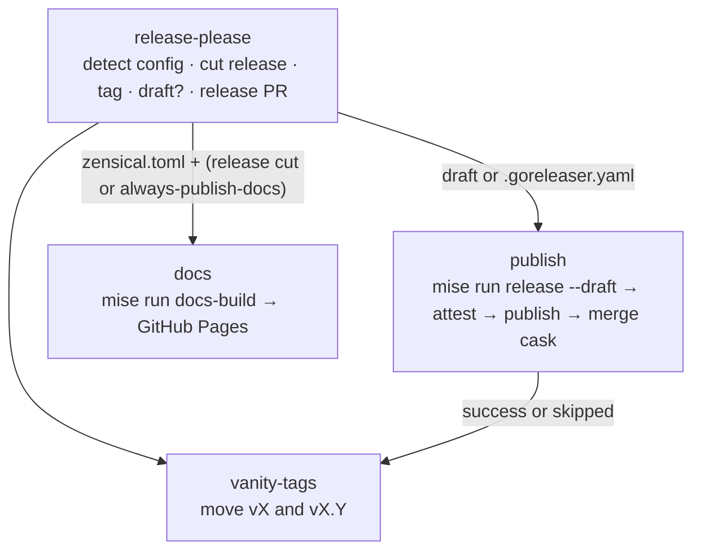

---
description:
  release-please releases, then the repository's `release` task (GoReleaser binaries, signed, notarized and attested, or
  any other build and registry publish) and/or a Zensical docs deploy (per release, or optionally every push to main),
  then floating major/minor tags.
---

# `release.yaml`

**Reusable Release.** release-please keeps a release PR up to date from the Conventional Commit history. When that PR
merges, the run cuts the release. What follows depends on the release and on which config files the repository has:

| Release / repository has                     | Path taken                                                                                     |
| -------------------------------------------- | ---------------------------------------------------------------------------------------------- |
| a **draft** release, or a `.goreleaser.yaml` | **`publish`**: `mise run release --draft`, attestations, Homebrew cask, then publish the draft |
| `zensical.toml`                              | **`docs`**: `mise run docs-build`, then deploy `./site` to GitHub Pages                        |
| both                                         | both jobs, in parallel                                                                         |
| neither (a non-draft release, no goreleaser) | the release-please cut is the release                                                          |

The `publish` job doesn't care which tool the `release` task drives. The go and swift archetypes run GoReleaser; a
TypeScript or Python archetype can build with GoReleaser and then `npm publish` / `uv publish`. A draft release is the
signal, not the task: the go archetype defines `release` in every Go repository, libraries included, and a library cuts
a non-draft release with nothing to build.

With `vanity-tags: true`, a final job moves the floating `vX` and `vX.Y` tags to the release commit. With
`always-publish-docs: true`, the `docs` job also runs on every push to `main`, not only when a release is cut.

A repository whose products are `patchy build` artifacts adds a job after this workflow that runs the
[`patchy-publish`](../actions/patchy-publish.md) action: edge builds when no release is cut, and promotion to `vX.Y.Z`
when one is. It runs in the caller's own job so the artifacts are signed with the repository's identity.

!!! abstract "At a glance"

    - **Caller triggers:** `push` to `main` (plus `workflow_dispatch` to retry a run that failed at startup)
    - **Caller grants:** all eight scopes below, **even for jobs that will be skipped**
    - **Secrets:** optional: the FF Merge App key; the five `macos-*` notarization secrets
    - **Repository needs:** `release-please-config.json` + `.release-please-manifest.json`

## How it works



### Runner

Every job runs on the `runs-on` input, `ubuntu-latest` by default. A repository whose `release` or `docs-build` task
needs macOS (say, a docs demo rendered by a Swift CLI that links AVFoundation) passes `runs-on: macos-latest`. The
`publish` and `docs` jobs' single Setup mise step installs and verifies the mise binary for the runner's platform, so
nothing else changes. Container images (a root `Dockerfile`) still need a Linux runner, and notarization doesn't need
macOS at all. See [Platform](index.md#platform).

### `release-please`

1. Checks out the repository so `hashFiles()` can detect `.goreleaser.yaml` / `.goreleaser.yml` and `zensical.toml`. A
   job-level `if:` runs before checkout, so detection is published as job outputs.
2. If `app-client-id` is set, mints a short-lived **GitHub App token** (`contents` + `pull-requests` write).
3. **Pass one** runs release-please with `skip-github-pull-request`. It only cuts a release, and only when a release PR
   has just merged.
4. **Creates the tag** at the released commit if it doesn't exist. A **draft** release (`draft: true`) has no tag yet,
   and the release task (GoReleaser, say) can't version without one. For a non-draft release the call is idempotent.
5. **Reads the draft flag** of the release just cut, from the releases list (a draft doesn't resolve by tag). A draft,
   or a `.goreleaser.yaml`, selects the `publish` job.
6. **Pass two** runs release-please with `skip-github-release` and refreshes the release PR. This happens _after_ the
   tag exists: a draft release without a tag ref is invisible to release-please's lookup, and a single pass would open a
   duplicate release PR.

The job's results become the workflow's outputs (see [Interface](#interface)), so a caller can add release-only jobs.

### `publish`

Runs only when a release was cut, the release is a draft or `.goreleaser.yaml` exists, and the trigger is `push`,
`workflow_dispatch` or `schedule`. That trigger list is an allowlist: the job fails closed on any other event, such as a
misconfigured `pull_request_target` caller.

1. On a Linux runner, frees root-disk space by deleting the preinstalled SDKs (Android, .NET, GHC, CodeQL, PowerShell)
   and pruning Docker images. The paths are the Ubuntu image's, so the step is skipped on macOS.
2. Checks out the **release tag** with full history and submodules.
3. Installs mise **without any cache**. A cache poisoned from a less-trusted run must not feed signed, attested
   artifacts. The language toolchain, goreleaser, cosign and syft all come from the repository's mise pins, so the
   release uses the same versions as a local `mise run release`.
4. If a root `Dockerfile` / `Dockerfile.*` exists: sets up QEMU and buildx and logs in to `ghcr.io` for GoReleaser's
   `dockers_v2`.
5. If the config declares `homebrew_casks`: fails immediately without `app-client-id`, otherwise mints an App token
   scoped to **only** the tap repository (`contents` + `pull-requests` write).
6. Fails if no `release` mise task exists, leaving the draft. The go and swift archetypes define it as
   `goreleaser release --clean`.
7. Runs **`mise run release --draft`** with `GITHUB_TOKEN`, `HOMEBREW_TAP_GITHUB_TOKEN` and the five `MACOS_*`
   variables. Whatever the tool, the task fills the draft and must not publish it; for GoReleaser, `--draft` overrides
   the config. A task that also pushes to npm or PyPI does that **last**, after everything else in the task that can
   fail, because registry uploads are immutable too.
8. **Attests** SLSA build provenance for every file in `dist/checksums.txt` (sha256sum format), and for every image in
   `dist/digests.txt` when the repository builds images. A task that writes no `dist/checksums.txt` skips the file
   attestation, except with a `.goreleaser.yaml`, where a missing file fails the step.
9. **Publishes** the draft release, as the last step that can fail. Published releases are immutable, so everything that
   can go wrong happens while the release is still a draft that can be deleted and re-run.
10. **Merges the cask PR** in the tap (`bot/<repo>-<tag>`, squash) only now that the assets are public, so the tap never
    points at draft assets that 404.

### `docs`

Same trigger allowlist, gated on `zensical.toml`. Independent of `publish`, so the two run in parallel.

When it runs is a per-repository choice:

| `always-publish-docs` | Publishes                                                                | Builds                                                        |
| --------------------- | ------------------------------------------------------------------------ | ------------------------------------------------------------- |
| `false` (default)     | only on a run that cut a release, so the site matches the latest release | the release tag                                               |
| `true`                | on every run on the default branch, release or not                       | the release tag on a release run, otherwise the pushed commit |

The always-publish path also requires the run's ref to be the default branch, so a `workflow_dispatch` from a feature
branch never publishes unreleased docs. The [caller](#caller) sets the input from the `ALWAYS_PUBLISH_DOCS` repository
variable, so a repository opts in by setting that variable to `true` without editing its caller.

1. Checks out the release tag (or, with no release, the pushed commit), with Git LFS objects and submodules.
2. Installs mise (cache on: nothing here is signed).
3. Fails if no `docs-build` mise task exists. The toolchain's common tasks define it.
4. Runs `mise run docs-build`, which renders into `./site`.
5. Configures Pages, uploads `./site`, and deploys to the `github-pages` environment. Deploys are serialised in the
   `pages` concurrency group and never cancelled; with `always-publish-docs`, a newer pending deploy replaces an older
   pending one, so a burst of pushes converges on the latest commit.

A repository whose docs embed generated content overrides `docs-build` to generate it first. This repository does that.
See [Working on the docs](../reference/docs.md).

### `vanity-tags`

Runs when `vanity-tags: true` and a release was cut, **after `publish` succeeded or was skipped**. A failed release
never moves the tags. It force-moves `vX` and `vX.Y` (for example `v8` and `v8.1`) to the release SHA through the API,
with no checkout.

## Requirements

- `release-please-config.json` + `.release-please-manifest.json` at the root.
- **Publish path:** `"draft": true` in `release-please-config.json`, plus a `release` mise task (from a toolchain
  archetype, or your own) that accepts `--draft`, fills the draft and never publishes it. An overridden `release` task
  must leave the git tree clean. Go repositories also add `.goreleaser.yaml` with `release-type: go`, which on its own
  still selects the path.
- **Attestations:** write a sha256sum-format `dist/checksums.txt` listing the files to attest. GoReleaser does this by
  default.
- **Registry publishing (npm, PyPI):** set up trusted publishing for the repository on the registry. The `publish` job
  holds `id-token: write`, so the task authenticates with the job's OIDC token and needs no stored token.
- **Docs path:** `zensical.toml`, `pyproject.toml`, `uv.lock`, a `docs-build` mise task, and **Settings → Pages → Source
  → GitHub Actions**. To publish on every push to `main`, also set the repository variable `ALWAYS_PUBLISH_DOCS` to
  `true` (**Settings → Secrets and variables → Actions → Variables**).
- **Container images:** a root `Dockerfile` / `Dockerfile.*` and a `dockers_v2` block. Images go to `ghcr.io` with the
  job's `packages: write`. QEMU and buildx need a **Linux runner**, so keep the default `runs-on`.
- **Auto-merged release PRs:** pass `app-client-id` + `app-private-key` (the FF Merge App). A release PR pushed with the
  default `GITHUB_TOKEN` emits no `workflow_run` events, because GitHub suppresses them to prevent recursion.
  [`merge.yaml`](merge.md)'s auto-merge listens for `workflow_run`, so it would never fire and the PR would only land on
  the hourly sweep.
- **Homebrew cask:** the App above, installed on the tap repository, and a cask config that opens a PR from
  `bot/<repo>-{{ .Tag }}`:

  ```yaml title=".goreleaser.yaml"
  homebrew_casks:
    - repository:
        owner: bitwise-media-group
        name: homebrew-tap
        branch: bot/<repo>-{{ .Tag }} # the branch the workflow merges from
        token: "{{ .Env.HOMEBREW_TAP_GITHUB_TOKEN }}"
        pull_request:
          enabled: true
          base:
            owner: bitwise-media-group
            name: homebrew-tap
            branch: main
  ```

  There is no PAT path. A cask without `app-client-id` fails before anything is built.

- **macOS signing and notarization:** a `notarize.macos` block and the five `macos-*` secrets. See
  [macOS notarization](../setup/macos-notarization.md).

## Interface

--8<-- "build/workflow-docs/release/interface.md"

Gate follow-on jobs in the caller on `release_created`:

```yaml
jobs:
  release:
    uses: bitwise-media-group/github-workflows/.github/workflows/release.yaml@<sha> # vX.Y.Z
  announce:
    needs: release
    if: needs.release.outputs.release_created
    runs-on: ubuntu-latest
    steps:
      - run: echo "released ${{ needs.release.outputs.tag_name }}"
```

## Permissions

--8<-- "build/workflow-docs/release/permissions.md"

!!! warning "Grant everything, even on a docs-only or tag-only repository"

    A repository that cuts no draft release never runs the `publish` job, but GitHub still checks its
    `id-token` / `attestations` / `artifact-metadata` / `packages` scopes, and the docs job's `pages`, when the run
    starts. Leave any out and the whole run fails at startup. Only the jobs that actually run receive their
    narrower job-level grants.

## Caller

```yaml title=".github/workflows/release.yaml"
--8<-- "examples/release.yaml"
```

## Jobs and pinned actions

--8<-- "build/workflow-docs/release/jobs.md"

--8<-- "build/workflow-docs/release/actions.md"

## Troubleshooting

The run shows `startup_failure` with no jobs : The caller is missing a permission (see above), or an org Actions policy
rejected an action. GitHub won't re-run a run that created no jobs, so add `workflow_dispatch` to the caller to start a
fresh one.

A release PR merged but only a draft release exists : The `publish` job failed before **Publish release**. Fix the
cause, delete the draft (and the tag, if you want a clean re-cut), and re-run.

`the release is a draft or .goreleaser.yaml exists, but no 'release' mise task is defined` : The repository's mise
config doesn't include an archetype that provides `release`. Include one, or define the task. The draft is left in place
for the re-run. A repository that has nothing to build should set `"draft": false` instead.

The package is on npm or PyPI but the GitHub release is still a draft : The task's registry push succeeded and a later
step failed (an attestation, or **Publish release**). The registry version is immutable, so don't re-run the task: fix
the cause, then publish the draft by hand (`gh release edit <tag> --draft=false`). Keep the registry push last in the
task so this can only happen after every asset is uploaded.

`.goreleaser.yaml publishes a Homebrew cask, which needs app-client-id…` : Pass `app-client-id` and `app-private-key`,
and install the App on the tap repository.

`no open cask pull request from bot/<repo>-<tag>` : A warning, not a failure: the cask config pushes straight to `main`
rather than opening a PR. Switch it to the branch + `pull_request` form above.

Docs publish on every push to `main` but should only follow releases : The repository variable `ALWAYS_PUBLISH_DOCS` is
`true` (or the caller hard-codes `always-publish-docs: true`). Delete the variable or set it to anything else.

`ALWAYS_PUBLISH_DOCS` is set but docs still only publish on release : The value must be exactly `true` (lower case), the
caller must pass `always-publish-docs` (older copies of the example don't), and the push must be to the default branch.

A tool install fails in `publish` or `docs` on a non-default `runs-on` : `mise.lock` has no entry for the runner's
platform, and `--locked` refuses to install without one. Add the platform to the lock, or use a runner it covers.

Duplicate release PRs : Runs queue in the `release` concurrency group, and the two-pass design prevents the draft-tag
race. A duplicate usually means the tag was deleted by hand after a release.
