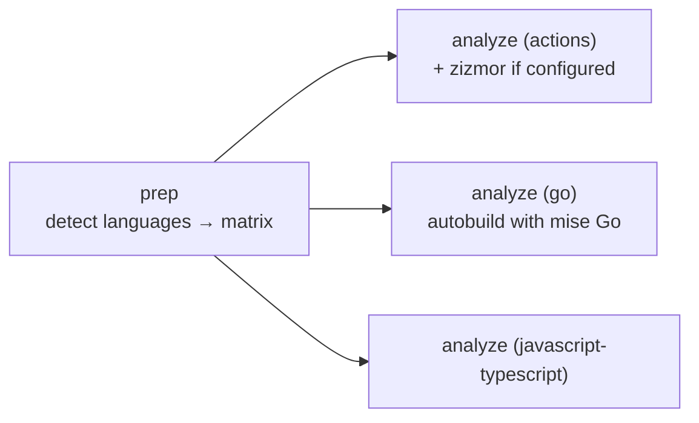

---
description:
  CodeQL code scanning over actions, plus go and javascript-typescript when detected, and zizmor when the repo opts in.
---

# `security.yaml`

**Reusable Security Analysis.** CodeQL code scanning with a language matrix detected from the repository root. GitHub
Actions workflows are always scanned. Go and JavaScript/TypeScript are added when the repository has them. Repositories
that ship a zizmor config also get a zizmor audit of their workflows, uploaded to code scanning next to CodeQL.

!!! abstract "At a glance"

    - **Caller triggers:** `push` to `main`, `pull_request` to `main` / `releases/*`, and a weekly `schedule`
    - **Caller grants:** `security-events: write`, `packages: read`, `actions: read`, `contents: read`
    - **Secrets:** none
    - **Repository needs:** nothing for `actions`; a mise config with a Go pin for the `go` leg

## How it works



1. **`prep`** checks out the repository and builds the matrix:

   | Language                | Added when                   | Build mode  |
   | ----------------------- | ---------------------------- | ----------- |
   | `actions`               | always                       | `none`      |
   | `go`                    | a root `go.mod` exists       | `autobuild` |
   | `javascript-typescript` | a root `package.json` exists | `none`      |

   A non-empty `languages` input replaces detection with that list verbatim. `go` gets `autobuild` and anything else
   gets `none`. Only a **root** `go.mod` counts as Go: the `go.work` + `tools/go.mod` that most repositories carry for
   `go tool addlicense` is tooling, not product code.

2. **`analyze`** runs one leg per language (`fail-fast: false`):
   - The `go` leg alone checks out submodules and installs **only Go** from the repository's mise pins. CodeQL's
     autobuild then compiles with the same toolchain the repository's build uses. Go has no build-free mode.
   - CodeQL initialises with the language, build mode and optional `config-file`, then analyses and uploads under the
     category `/language:<lang>`.
   - On the `actions` leg, if `zizmor.yml` or `zizmor.yaml` exists at the root or under `.github/`, zizmor audits the
     workflows and uploads its SARIF to code scanning. In SARIF mode zizmor never fails the run. Findings appear as
     code-scanning alerts.

## Requirements

- Nothing for the default `actions` leg.
- For Go: a root `go.mod` and a mise config that pins `go`. The `go` leg fetches submodules so the toolchain at `.mise/`
  resolves.
- A repository with a **bundled `dist/`** (a JavaScript Action) should pass `config-file` pointing at a copy of
  [`examples/codeql-config.yaml`](#codeql-config), which excludes `dist/` so vendored dependencies don't raise false
  positives.
- A repository whose `package.json` is only tooling (prettier, markdownlint) should pass `languages: actions` to skip an
  empty JavaScript leg. This repository does that.
- **zizmor (optional):** add `.github/zizmor.yaml`. Even an empty file opts in. This repository's own config is a good
  start:

  ```yaml title=".github/zizmor.yaml"
  --8<-- ".github/zizmor.yaml"
  ```

!!! warning "Don't enable CodeQL default setup or Code quality"

    Repository-level **default setup** conflicts with this advanced (workflow) setup. The **Code quality** feature
    ignores the config file and would scan a committed `dist/` bundle.

## Interface

--8<-- "build/workflow-docs/security/interface.md"

## Permissions

--8<-- "build/workflow-docs/security/permissions.md"

## Caller

```yaml title=".github/workflows/security.yaml"
--8<-- "examples/security.yaml"
```

### CodeQL config

For a repository with a committed `dist/`, copy this to `.github/codeql/codeql-config.yaml` and pass
`config-file: ./.github/codeql/codeql-config.yaml`:

```yaml title=".github/codeql/codeql-config.yaml"
--8<-- "examples/codeql-config.yaml"
```

## Jobs and pinned actions

--8<-- "build/workflow-docs/security/jobs.md"

--8<-- "build/workflow-docs/security/actions.md"

## Troubleshooting

An empty `javascript-typescript` leg fails or reports nothing : The `package.json` holds only tooling. Pass
`languages: actions` (or `actions,go`).

The `go` leg fails in autobuild : Autobuild needs `go` on `PATH` from the mise pins. Check that the repository's mise
config pins Go and that `.mise/` is a committed submodule.

zizmor findings don't show up : zizmor runs only on the `actions` leg and only when a config file exists at one of the
four paths above.
